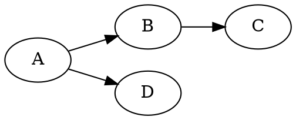

# Graphviz diagrams

将 Chat 中的 `dot`、`graphviz`、`gv` 代码围栏渲染为可交互的 Graphviz SVG 图形。源码编辑、布局切换与流式状态都在同一个面板内完成。

## 功能

- **三种围栏语言**：`dot`、`graphviz`、`gv`；其他语言的代码块保持原样。
- **流式安全**：围栏仍在生成时显示原始代码，内容稳定后才调用引擎。
- **三种布局**：上图下文（TB）、左右分栏（LR）、仅图形（Graph）。
- **宽度铺满、高度自适应**：默认视图按面板宽度等比铺满图形（小图最多放大 2×，避免过度放大），面板高度完全跟随图形高度（像网页一样向下延伸，不设固定视窗、不裁切）；聊天区滚动即可看全。
- **缩放与平移**：工具栏 `− / 百分比 / + / ↺`、滚轮围绕指针缩放、指针拖动平移、双击重置；范围 25%–600%，支持键盘 `+`/`-`/`0` 与方向键。放大后图形变宽，左右拖动查看。
- **放大查看**：在 92vh 覆盖层里改用「适应视窗」的整图预览（受限视窗），适合先看全貌再回到页面视图放大细节。
- **折叠**：工具栏「折叠」把面板收成一行，折叠期间不渲染、不加载引擎；展开后自动恢复。
- **锁定尺寸**：工具栏🔒锁定后编辑器分割条不可拖动，避免误拖改变源码/图形比例；🔓恢复。
- **可调分隔条**：鼠标/触控拖动，聚焦后用方向键、Home、End 调整。
- **源码编辑**：Monaco 提供 DOT 高亮与补全（固定 0.52.2，来自 jsDelivr CDN）；CDN 不可用时自动降级为纯文本输入框，编辑与渲染继续可用。
- **主题适配**：面板使用 DSH 主题 token；Graphviz 的黑色描边和文字会映射到当前主题前景色，浅色填充节点上的文字自动改为深色。
- **安全渲染**：SVG 先经 allowlist 清洗，移除脚本、`foreignObject`、事件属性和危险 URL，并按实例前缀隔离 id。
- **错误提示**：语法或引擎错误显示在图形区域，修正源码或点击重试即可恢复。

## 用法

````markdown

````

渲染完成后可在编辑器中修改源码，图形会去抖更新。图形中的 `href` 链接会在新标签页打开。

## 引擎

渲染使用 [`@viz-js/viz`](https://github.com/mdaines/viz-js) 的完整版构建（Graphviz 16.1.0，WebAssembly 内联）。引擎被构建为插件内的 `client.engine.js` chunk，只在首次需要渲染时由 DSH 客户端模块系统加载，随后复用同一实例；它不从 CDN 下载，仓库也不保存 `full.render.js` 拷贝。

## 限制

- 仅输出 SVG，仅使用 `dot` 布局引擎。
- 引擎 chunk 约 1.5 MB，首次渲染需要下载并初始化 WASM；之后不再重复加载。
- 超大图在主线程布局，可能造成短暂卡顿。
- 源码编辑的语法高亮与补全需要联网加载 Monaco；离线时自动使用纯文本编辑器。
- 不提供 PNG/PDF 导出。

## 唯一实现与交付记录

`@limix/dsh-graphviz`（Loader 行 `dsh-graphviz`）是仓库唯一的 Graphviz 围栏渲染插件：同一 profile 中不应再安装其他注册 `dot`/`graphviz`/`gv` 的插件，否则同一围栏会被重复渲染。

OpenSpec 交付记录随 bundle 维护：`openspec/specs/` 是主规格，`openspec/changes/archive/` 保存归档变更，二者都在发布 `files` 清单内。在仓库根目录执行 `openspec list --specs` 或 `openspec validate --strict` 即可审阅与校验。
