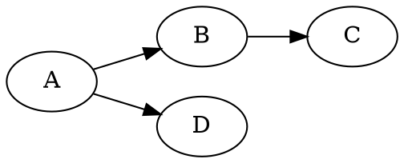

# Graphviz diagrams

Interactive Graphviz SVG diagrams for `dot`, `graphviz`, and `gv` code fences in Chat. Source editing, layout switching, and streaming state all happen inside one panel.

## Features

- **Three fence languages**: `dot`, `graphviz`, `gv`; code blocks in any other language stay untouched.
- **Streaming safety**: while the fence is still being generated the raw code is shown, and the engine only runs once the content settles.
- **Three layouts**: editor above graph (TB), editor beside graph (LR), and graph only.
- **Width fills, height follows**: the default view scales the diagram to the panel width (small diagrams are magnified at most 2×), and the panel height follows the diagram exactly like a web page — no fixed inner viewport, no cropping; scroll the conversation to see the whole diagram.
- **Zoom and pan**: toolbar `− / percentage / + / ↺`, wheel zoom around the pointer, drag to pan, double-click to reset; range 25%–600%, plus keyboard `+`/`-`/`0` and arrow keys. Zooming widens the diagram, and dragging reveals the overflow horizontally.
- **Maximized view**: a 92vh overlay switches to a bounded “fit the whole diagram” preview, useful for an overview before returning to the page-like view for detail.
- **Collapse**: the toolbar collapses the panel to a single row; while collapsed no rendering happens and no engine work starts, and expanding restores it automatically.
- **Lock size**: the toolbar lock makes the editor splitter non-draggable, so an accidental drag cannot change the source/graph ratio.
- **Adjustable splitter**: drag with mouse or touch, and adjust from the keyboard with arrow keys, Home, and End.
- **Source editing**: Monaco provides DOT highlighting and completion (pinned 0.52.2 from the jsDelivr CDN); when the CDN is unavailable it falls back to a plain text field while editing and rendering keep working.
- **Theme adaptation**: the panel uses DSH theme tokens; Graphviz black strokes and text map to the current theme foreground, and text on light fills switches to a dark color automatically.
- **Safe rendering**: SVG passes through an allowlist sanitizer that removes scripts, `foreignObject`, event attributes, and dangerous URLs, and isolates ids with a per-instance prefix.
- **Error reporting**: syntax or engine errors appear inside the graph area; fixing the source or pressing retry recovers.
- **Sidebar `.dot` preview**: opening a `.dot` file from the file navigator reuses this panel in the right Sidebar; the renderer dropdown keeps the builtin plain-text viewer available. Editing is a local draft because the Sidebar file API is read-only.

## Usage

````markdown

````

After rendering, edit the source in the editor and the diagram updates after a debounce. `href` links inside the diagram open in a new tab.

## Engine

Rendering uses the full build of [`@viz-js/viz`](https://github.com/mdaines/viz-js) (Graphviz 16.1.0, WebAssembly inlined). The engine is built as the plugin-local `client.engine.js` chunk, loaded by the DSH client module system on the first render and reused afterwards; it never downloads from a CDN, and the repository keeps no copy of `full.render.js`.

## Limits

- SVG only, and only the `dot` layout engine.
- The engine chunk is about 1.5 MB; the first render downloads and initializes the WASM, and later renders reuse it.
- Very large diagrams lay out on the main thread and may cause a brief stall.
- Syntax highlighting and completion for the source editor need network access for Monaco; offline it falls back to a plain text editor.
- No PNG/PDF export.

## Single implementation and delivery record

`@limix/dsh-graphviz` (Loader row `dsh-graphviz`) is the repository's only Graphviz fence renderer: do not install another plugin that registers `dot`/`graphviz`/`gv` in the same profile, or the same fence renders twice.

The OpenSpec delivery record ships with the bundle: `openspec/specs/` holds the main specs and `openspec/changes/archive/` keeps archived changes, and both are inside the published `files` list. Run `openspec list --specs` or `openspec validate --strict` at the repository root to review and validate.
